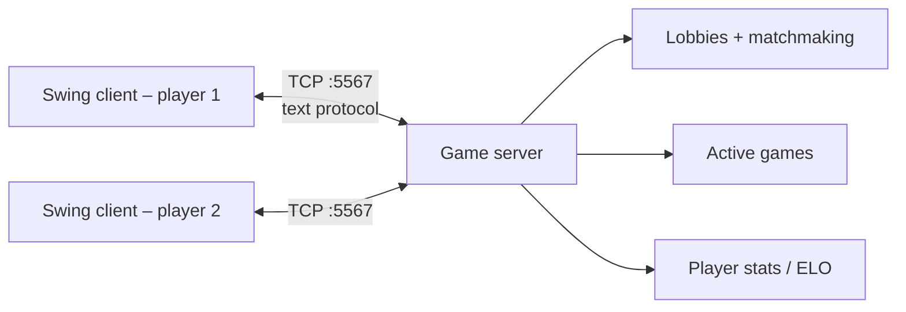

# Multiplayer Tic-Tac-Toe – Java Sockets & Swing


A networked, multiplayer tic-tac-toe game: a **multi-threaded TCP server** runs lobbies, matchmaking and games, and a **Java Swing desktop client** lets players chat, play, rematch and follow an **ELO leaderboard**. It's built with the standard library only (about 3,000 lines of Java).

---

## Features

**Server** (`TicTacToeServer.java`)
- One `ClientHandler` thread per connected player
- Lobbies, matchmaking queue and active games kept in concurrent collections (`ConcurrentHashMap`)
- Full game state on the server (board, turns, win/draw detection), so clients can't cheat
- Player profiles with **ELO rating** (starting at 1200), wins, losses and draws
- Lobby chat, in-game chat, rematch requests and a leaderboard
- Event logging and periodic server statistics (uptime, active connections)

**Client** (`TicTacToeClient.java`)
- Tabbed Swing UI: **Game**, **Lobby**, **Leaderboard**, **Profile**
- Custom `Graphics2D` board that draws the marks and the winning line and handles mouse moves
- Background listener thread for server messages, with UI updates on the Swing event thread
- Connection-status indicator and **automatic reconnection**
- Light / dark theme, sound effects, configurable server address and port

**Launcher** (`TicTacToeMain.java`) – a small window with *Start Server* and *Start Client* buttons.

## Architecture



### Protocol

Plain-text commands over one TCP connection per player:

| Client → server | Server → client |
|---|---|
| `NAME:<name>` | `JOINED_LOBBY:<id>:<name>` |
| `FIND_GAME` | `GAME_STARTED:...` |
| `MOVE:<cell>` | `BOARD:...`, `YOUR_TURN` |
| `LOBBY_CHAT:<msg>` / `GAME_CHAT:<msg>` | `LOBBY_CHAT:<from>:<msg>` |
| `REMATCH:...`, `REMATCH_ACCEPT`, `REMATCH_DECLINE` | `GAME_OVER:...` |
| `GET_LEADERBOARD`, `JOIN_LOBBY:<id>` | `LOBBY_LIST:...`, `LOBBY_JOIN:` / `LOBBY_LEAVE:` |

## How to run

Requires a JDK 8+. From the repository root:

```bash
javac -d out *.java
java -cp out TicTacToee.TicTacToeMain
```

Click **Start Server** once, then **Start Client** twice (or run clients on other machines and enter the server's IP address). In each client, click **Connect to Server** and then **Find Game**, and the server pairs the two players.

## Concepts covered

TCP client/server design · designing a custom application protocol · thread-per-connection concurrency · thread-safe shared state · event-driven GUI programming · keeping the Swing UI thread separate from network I/O

## Author

**Mohammed Anes Boucetla** – [github.com/moxaness](https://github.com/moxaness)
